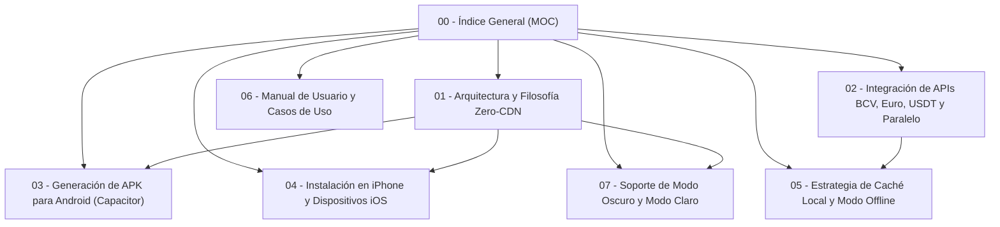

# 🧮 Bóveda de Documentación: CalculaVE
> **Ecosistema Móvil 100% Offline con Conexión Multimoneda BCV, Euro, USDT, Modo Oscuro/Claro y Generación de APK para Android & iOS**
> **Autor:** Luis David Rivero Carmona ([@eLerivero](https://github.com/eLerivero)) · [LinkedIn](https://www.linkedin.com/in/luis-rivero-b88603241/)

Bienvenido a la documentación técnica y operativa de **CalculaVE**. Esta bóveda de notas para [[Obsidian]] contiene las especificaciones de arquitectura, integración de APIs de divisas venezolanas en tiempo real, empaquetado para celulares, soporte de temas dinámicos y estrategias de funcionamiento sin dependencias externas (*Zero-CDN*).

---

## 🗺️ Mapa de Contenido (MOC)

### 📑 Secciones Principales

1. [[01 - Arquitectura y Filosofía Zero-CDN|Arquitectura y Filosofía Zero-CDN]]
   * Eliminación de CDNs (Google Fonts, Tailwind, Lucide, Particles.js).
   * Motor de partículas nativo en HTML5 Canvas.
   * Sistema de diseño responsivo y *Glassmorphism*.

2. [[02 - Integración de APIs BCV, Euro, USDT y Paralelo|Integración de APIs BCV, Euro, USDT y Paralelo]]
   * Endpoint oficial del Banco Central de Venezuela (BCV).
   * Cotización oficial del Euro BCV.
   * Cotización en vivo de USDT (Binance P2P Venezuela).
   * Tasa del mercado Paralelo y modo de Tasa Personalizada.
   * Mecanismo de reintentos (*fallback*) y tolerancia a desconexión.

3. [[03 - Generación de APK para Android (Capacitor)|Generación de APK para Android con Capacitor]]
   * Configuración de Capacitor CLI (`@capacitor/android`).
   * Compilación del binario instalable `.apk` para Android.
   * Métodos sin Android Studio vs con Android Studio.

4. [[04 - Instalación en iPhone y Dispositivos iOS|Instalación en iPhone y Dispositivos iOS (PWA)]]
   * Despliegue en Safari sin tienda ni certificados de pago.
   * Configuración de meta etiquetas Apple (`apple-mobile-web-app-capable`).
   * Adaptación de áreas seguras (*Safe Area Insets*) para Dynamic Island y Notch.

5. [[05 - Estrategia de Caché Local y Modo Offline|Estrategia de Caché Local y Modo Offline]]
   * Ciclo de vida del Service Worker (`sw.js`).
   * Almacenamiento local persistente (`localStorage`) de tasas y cálculos.
   * Estrategia de red *Cache-First*.

6. [[06 - Manual de Usuario y Casos de Uso|Manual de Usuario y Casos de Uso]]
   * Flujo de cálculo bidireccional USD/EUR a Bolívares.
   * Copia en un toque para **Pago Móvil**.
   * Compartir cotizaciones formateadas por WhatsApp.

7. [[07 - Soporte de Modo Oscuro y Modo Claro|Soporte de Modo Oscuro y Modo Claro]]
   * Variables CSS nativas y selector `data-theme`.
   * Inicialización Zero-FOUC (sin parpadeos).
   * Adaptación de partículas en Canvas y sincronización con barra de estado.

---

> [!tip] ¿Cómo abrir esta carpeta en Obsidian?
> 1. Abre tu aplicación **Obsidian**.
> 2. Haz clic en **Abrir carpeta como bóveda** (*Open folder as vault*).
> 3. Selecciona la carpeta `docs-obsidian` de este proyecto.
> 4. Todos los enlaces entre notas, etiquetas y gráficos funcionarán de manera interactiva.
