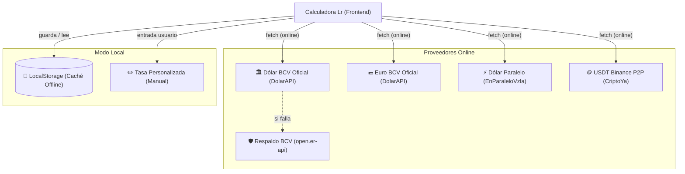

# 💱 Integración de APIs de Divisas en Vivo

Para garantizar que el usuario siempre cuente con la cotización exacta del día en Venezuela, la **Calculadora Lr** cuenta con un motor multimoneda con soporte para **5 fuentes distintas** de tasa cambiaria:



---

## 📡 Catálogo de Endpoints y Esquemas JSON

### 1. Dólar Oficial BCV (Banco Central de Venezuela)
* **Endpoint Primario:** `https://ve.dolarapi.com/v1/dolares/oficial`
* **Método:** `GET`
* **CORS:** Habilitado (`Access-Control-Allow-Origin: *`)
* **Esquema de Respuesta:**
  ```json
  {
    "moneda": "USD",
    "fuente": "oficial",
    "nombre": "Dólar",
    "promedio": 875.6505,
    "fechaActualizacion": "2026-10-09T00:00:00-04:00"
  }
  ```
* **Extracción en JS:** `parseFloat(data.promedio)`

### 2. Euro Oficial BCV
* **Endpoint:** `https://ve.dolarapi.com/v1/euros/oficial`
* **Método:** `GET`
* **Esquema de Respuesta:**
  ```json
  {
    "moneda": "EUR",
    "fuente": "oficial",
    "nombre": "Euro",
    "promedio": 980.6147,
    "fechaActualizacion": "2026-10-09T00:00:00-04:00"
  }
  ```

### 3. Dólar Paralelo (Monitor Venezuela)
* **Endpoint:** `https://ve.dolarapi.com/v1/dolares/paralelo`
* **Método:** `GET`
* **Esquema de Respuesta:**
  ```json
  {
    "moneda": "USD",
    "fuente": "paralelo",
    "nombre": "Paralelo",
    "promedio": 1007.6643,
    "fechaActualizacion": "2026-10-12T21:01:04.382Z"
  }
  ```

### 4. USDT Cripto (Binance P2P Venezuela)
* **Endpoint:** `https://criptoya.com/api/usdt/ves`
* **Método:** `GET`
* **Esquema de Respuesta:**
  ```json
  {
    "binancep2p": {
      "ask": 1012.90,
      "bid": 1013.00,
      "time": 1791860199
    }
  }
  ```
* **Extracción en JS:** `parseFloat(data.binancep2p.bid || data.binancep2p.ask)`

### 5. Proveedor de Respaldo Automático (Fallback)
* **Endpoint:** `https://open.er-api.com/v6/latest/USD`
* Si el servicio de DolarAPI no responde en 5 segundos, la aplicación consulta de forma transparente el tipo de cambio VES en este servidor global.

---

## 🛡️ Mecanismo de Tolerancia a Fallos y AbortController

Las conexiones móviles en Venezuela pueden sufrir interrupciones frecuentes. Para evitar que la interfaz se congele esperando una respuesta infinita de red, todas las llamadas utilizan un temporizador con `AbortController`:

```javascript
async function fetchConTimeout(url, timeoutMs = 5000) {
    const controller = new AbortController();
    const id = setTimeout(() => controller.abort(), timeoutMs);
    try {
        const res = await fetch(url, { signal: controller.signal });
        clearTimeout(id);
        return res;
    } catch (err) {
        clearTimeout(id);
        throw err;
    }
}
```

> [!important] Funcionamiento en Modo Avión / Sin Internet
> Si no hay conexión o el dispositivo está desconectado:
> 1. El motor captura el error silenciosamente.
> 2. Carga de inmediato la **última tasa guardada** en `localStorage` ([[05 - Estrategia de Caché Local y Modo Offline|ver Estrategia de Caché]]).
> 3. El indicador cambia a `🟠 Modo Offline (Caché)` sin romper ningún cálculo.

---

## ✏️ Opción de Tasa Personalizada

El usuario puede seleccionar la píldora **✏️ Personalizada** o editar directamente el valor del input de la tasa. En cuanto se escribe un valor manual:
1. El sistema desvincula la tasa de las APIs remotas.
2. Guarda el valor preferido del usuario en `ratesCache.custom`.
3. Todo el desglose de precios (USD/EUR y Bs) se actualiza en tiempo real de acuerdo a ese valor.

---

## 🔗 Enlaces Relacionados
* Ver arquitectura completa: [[01 - Arquitectura y Filosofía Zero-CDN|Arquitectura Zero-CDN]]
* Ver estrategia de almacenamiento: [[05 - Estrategia de Caché Local y Modo Offline|Caché Local y Modo Offline]]
* Siguiente guía: [[03 - Generación de APK para Android (Capacitor)|Generación de APK para Android]]
