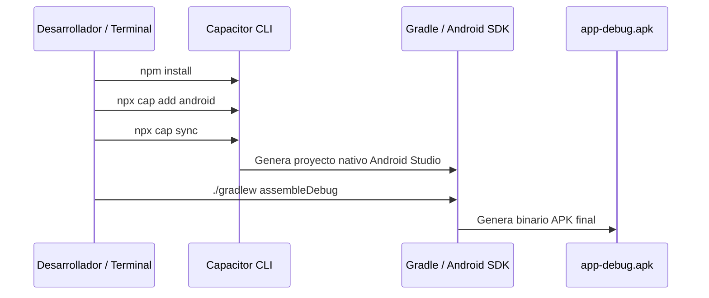

# 🤖 Generación de APK para Android (Capacitor)

Si deseas disponer del archivo físico ejecutable **`.apk`** para compartirlo por WhatsApp, instalarlo manualmente en cualquier celular Android o guardarlo en una memoria USB, este proyecto está preconfigurado con **Capacitor 6**.

Capacitor empaqueta el código HTML, CSS, JavaScript y los iconos locales dentro de un contenedor nativo **Android WebView** de máximo rendimiento.

---

## ⚙️ Archivos de Configuración Incluidos

En la raíz del proyecto ya cuentas con:
1. `package.json`: Contiene las dependencias `@capacitor/core`, `@capacitor/cli` y `@capacitor/android`.
2. `capacitor.config.json`:
   ```json
   {
     "appId": "com.lr.calculadora",
     "appName": "Calculadora Lr",
     "webDir": ".",
     "bundledWebRuntime": false,
     "server": {
       "androidScheme": "https"
     }
   }
   ```

---

## 🛠️ Paso a Paso para Compilar el APK



### 1. Instalar Dependencias de Capacitor
Abre tu terminal en la carpeta del proyecto:
```bash
cd /Users/elerivero/.gemini/antigravity-ide/scratch/porcentajes-app
npm install
```

### 2. Inicializar la Plataforma Android
Crea la carpeta y el proyecto nativo de Android:
```bash
npx cap add android
npx cap sync
```

### 3. Generar el Archivo `.apk`

Tienes dos alternativas para compilar:

#### Opción A: Usando Android Studio (Gráfico y Recomendado)
1. Ejecuta:
   ```bash
   npx cap open android
   ```
2. Android Studio se abrirá con el proyecto cargado.
3. En la barra superior, ve al menú:
   `Build` > `Build Bundle(s) / APK(s)` > **`Build APK(s)`**.
4. Al terminar la barra de progreso, haz clic en el mensaje emergente **"locate"** para abrir la carpeta con el archivo `.apk` generado.

#### Opción B: Por Línea de Comandos (Sin abrir la interfaz)
Si tienes el SDK de Android configurado en tus variables de entorno:
```bash
cd android
./gradlew assembleDebug
```
El archivo compilado quedará ubicado en:
```text
android/app/build/outputs/apk/debug/app-debug.apk
```

---

## 📲 ¿Cómo instalar el APK en tu teléfono?

1. Pasa el archivo `app-debug.apk` a tu teléfono (por cable USB, WhatsApp o Google Drive).
2. Toca el archivo desde el explorador de archivos de Android.
3. Si el sistema te pregunta, activa la opción **"Permitir instalar aplicaciones de fuentes desconocidas"**.
4. Presiona **Instalar** y ¡listo! La app aparecerá en tu cajón con el icono de la Calculadora Lr.

---

> [!tip] Alternativa sin compilar (WebAPK)
> Si no deseas instalar Android Studio en tu computadora, la aplicación ya es una **PWA completa**. Si la abres en Google Chrome en tu celular y tocas los tres puntos `⋮` > **"Instalar aplicación"**, Android genera automáticamente un **WebAPK nativo** en menos de 5 segundos.

---

## 🔗 Enlaces Relacionados
* Ver instalación en dispositivos Apple: [[04 - Instalación en iPhone y Dispositivos iOS|Instalación en iPhone / iOS]]
* Ver integración con BCV: [[02 - Integración de APIs BCV, Euro, USDT y Paralelo|Integración de APIs BCV]]
* Volver al índice: [[00 - Indice General (MOC)|Índice General]]
