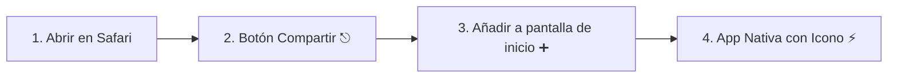

# 🍏 Instalación en iPhone y Dispositivos iOS

Un error común es asumir que un archivo `.apk` puede instalarse en un iPhone. Los archivos `.apk` son paquetes compilados exclusivamente para el sistema operativo Android. En el ecosistema de Apple, instalar aplicaciones de forma manual requiere compilar un archivo `.ipa` en una Mac con Xcode y renovar certificados personales cada 7 días, o pagar la suscripción anual de $99 USD a Apple Developer.

Para resolver esto con máxima elegancia y sin costos, la **Calculadora Lr** está configurada como una **PWA Standalone certificada para iOS**.

---

## 🚀 Paso a Paso: Instalación en Pantalla de Inicio

1. **Abrir en Safari:**
   Abre la aplicación desde tu iPhone usando **Safari** (puedes subir la carpeta a tu hosting/GitHub Pages o compartirla en tu red local WiFi).
   *(Nota: Apple solo permite la instalación de PWAs desde el motor de Safari).*

2. **Acceder al Menú Compartir:**
   En la barra inferior de Safari, presiona el icono central de **Compartir** (el cuadro con la flecha que apunta hacia arriba `⎋`).

3. **Añadir a Pantalla de Inicio:**
   Baja en el menú de opciones y selecciona **"Añadir a la pantalla de inicio"** (identificado con el icono `➕`).

4. **Confirmar:**
   Verás el nombre **Calculadora Lr** y el icono oficial en alta resolución. Presiona **Añadir** en la esquina superior derecha.

---

## ✨ Comportamiento Nativo en iOS

Una vez instalada:
* **Pantalla Completa (Standalone):** La aplicación se abre en una ventana independiente, sin la barra de direcciones de Safari ni los controles del navegador.
* **Icono Retina Oficial:** Utiliza la imagen `apple-touch-icon.png` (180x180 px con acabado en esquinas redondeadas automático de iOS).
* **Barra de Estado Translúcida:** Gracias a la etiqueta `<meta name="apple-mobile-web-app-status-bar-style" content="black-translucent">`, la barra de estado superior se funde con el degradado de fondo.
* **Soporte Dynamic Island & Notch:** La interfaz respeta `env(safe-area-inset-top)` y `env(safe-area-inset-bottom)`, evitando que los controles queden tapados.
* **Autonomía 100% Offline:** Safari almacena el Service Worker y todo el paquete en la caché permanente del iPhone, permitiendo abrirla incluso en Modo Avión.

---

> [!important] ¿Por qué es mejor que una app de la App Store para uso personal?
> * No requiere aprobación de Apple.
> * No caduca a los 7 días (como las apps instaladas por AltStore o Sideloadly).
> * Ocupa menos de 1 MB de almacenamiento en el iPhone.
> * Actualizaciones instantáneas cada vez que haya conexión a internet.

---

## 🔗 Enlaces Relacionados
* Ver instalación en Android: [[03 - Generación de APK para Android (Capacitor)|Generación de APK para Android]]
* Ver funcionamiento de caché: [[05 - Estrategia de Caché Local y Modo Offline|Caché Local y Modo Offline]]
* Volver al índice: [[00 - Indice General (MOC)|Índice General]]
