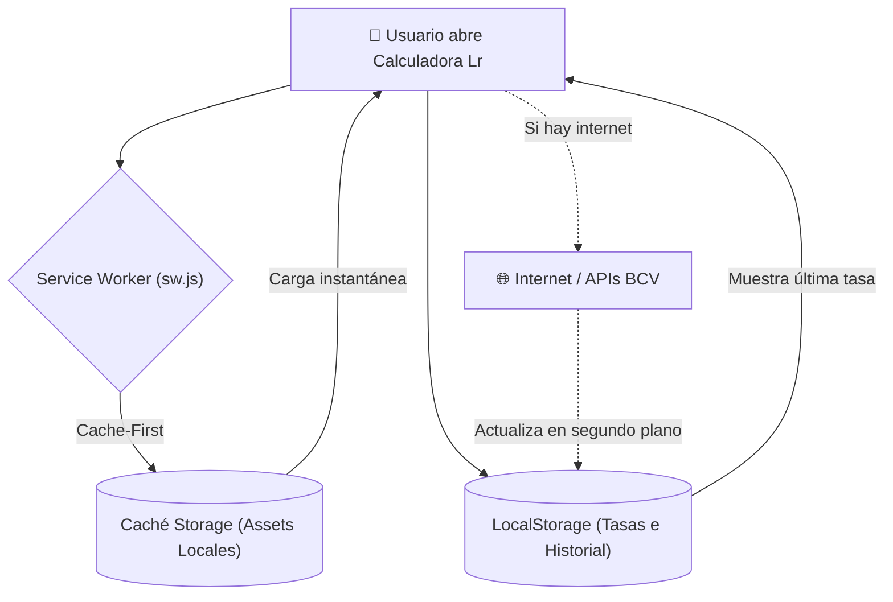

# 💾 Estrategia de Caché Local y Modo Offline

Uno de los requerimientos críticos de esta aplicación es que debe ser **inmune a caídas de internet**. Para lograr que funcione tanto en línea como desconectada, se combinan dos capas de almacenamiento en el dispositivo:



---

## ⚙️ 1. Service Worker: Estrategia Cache-First (`sw.js`)

El archivo `sw.js` intercepta cada petición antes de que salga a la red:

1. **Instalación (`install`):**
   Descarga y almacena de inmediato en caché todos los activos locales:
   * `./index.html`
   * `./manifest.webmanifest`
   * `./icon-192.png` y `./icon-512.png`
   * `./apple-touch-icon.png`
   * `./favicon.png`
   * `./icon.svg`

2. **Interceptación (`fetch`):**
   Aplica la estrategia **Cache-First**:
   * Primero busca el recurso en la caché del teléfono.
   * Si está en caché, lo devuelve a 0 ms sin tocar la red.
   * Si no está, lo descarga de internet y lo guarda para la próxima vez.

```javascript
// Estrategia Cache-First simplificada en sw.js
self.addEventListener('fetch', (event) => {
  if (!event.request.url.startsWith('http')) return;

  event.respondWith(
    caches.match(event.request).then((cachedResponse) => {
      if (cachedResponse) {
        return cachedResponse; // Retorno inmediato offline
      }
      return fetch(event.request);
    })
  );
});
```

---

## 🗄️ 2. Persistencia en `localStorage`

La aplicación utiliza dos claves principales en el almacenamiento local del navegador:

### A. Caché de Tasas de Cambio (`lr_multicurrency_rates_v1`)
Guarda las últimas tasas obtenidas con éxito para que, al reiniciar la aplicación sin señal, los precios no se reseteen a cero:

```json
{
  "bcv": { "valor": 875.65, "fecha": "Oct 12, 10:45 AM", "nombre": "Dólar BCV Oficial" },
  "eur": { "valor": 980.61, "fecha": "Oct 12, 10:45 AM", "nombre": "Euro BCV Oficial" },
  "paralelo": { "valor": 1007.66, "fecha": "Oct 12, 10:45 AM", "nombre": "Dólar Paralelo" },
  "usdt": { "valor": 1013.00, "fecha": "Oct 12, 10:45 AM", "nombre": "USDT Binance P2P" },
  "custom": { "valor": 875.65, "fecha": "Manual", "nombre": "Tasa Personalizada" }
}
```

### B. Historial de Cálculos (`lr_calc_history_v1`)
Conserva los últimos 15 cálculos realizados por el usuario (precio base, porcentaje de descuento aplicado, ahorro y monto total en bolívares).

---

## 📡 Detección Automática de Conectividad

La app escucha los eventos nativos del navegador:
* `window.addEventListener('online')`: Dispara la sincronización automática de las tasas con el BCV y muestra una notificación verde.
* `window.addEventListener('offline')`: Cambia el indicador a `🟠 Modo Offline (Caché)` y notifica al usuario que puede continuar operando con normalidad.

---

## 🔗 Enlaces Relacionados
* Ver integración de APIs: [[02 - Integración de APIs BCV, Euro, USDT y Paralelo|Integración de APIs BCV]]
* Ver manual operativo: [[06 - Manual de Usuario y Casos de Uso|Manual de Usuario]]
* Volver al índice: [[00 - Indice General (MOC)|Índice General]]
