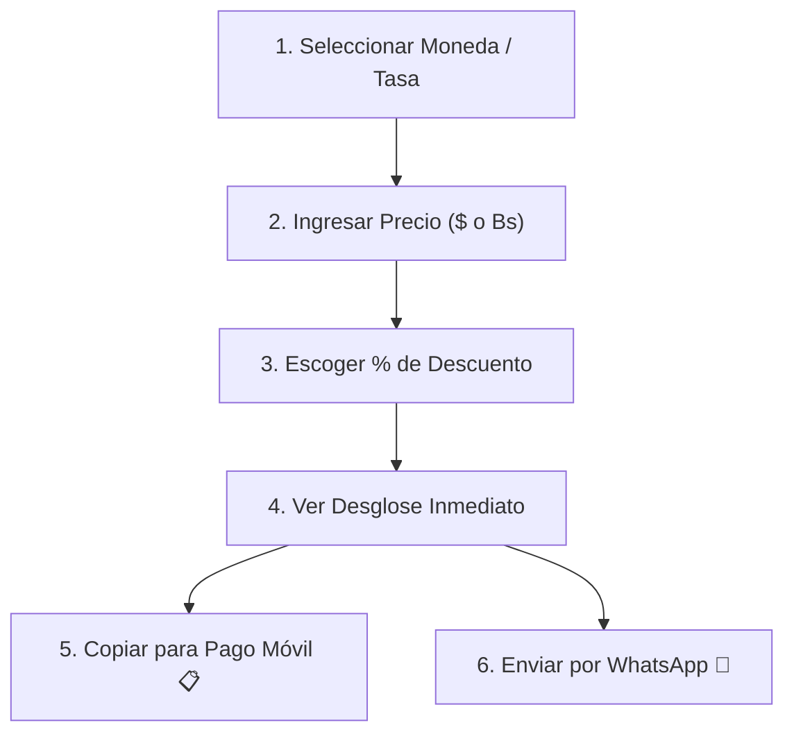

# 📖 Manual de Usuario y Casos de Uso

La **Calculadora Lr** está diseñada para agilizar el comercio diario y las transacciones personales en Venezuela, eliminando cálculos manuales propensos a error y facilitando pagos exactos en bolívares.

---

## 🚀 Flujo de Operación Paso a Paso



### 1. Seleccionar la Tasa de Cambio
En la barra de píldoras superior, toca la tasa con la que deseas cotizar:
* **🏛️ Dólar BCV:** Cotización oficial publicada por el Banco Central de Venezuela.
* **💶 Euro BCV:** Cotización oficial del Euro (ajusta los campos a `€ EUR`).
* **⚡ Paralelo:** Cotización del promedio del mercado libre.
* **🪙 USDT (P2P):** Tasa promedio de compra/venta en Binance P2P.
* **✏️ Personalizada:** Te permite escribir libremente cualquier tasa acordada (ej. `900`, `950`).

> [!tip] Botón Sincronizar
> Puedes presionar el botón **🔄 Sincronizar** en cualquier momento para obtener las tasas actualizadas al minuto.

---

### 2. Conversión Bidireccional Automática
* Si escribes en **Precio USD**, la app calcula al instante el valor equivalente en **Precio Bs**.
* Si escribes en **Precio Bs**, la app calcula al instante cuánto representa en **Precio USD**.

---

### 3. Aplicar Porcentaje de Descuento
* **Chips Rápidos:** Toca cualquiera de las opciones rápidas (`5%`, `10%`, `15%`, `20%`, `27%`, `30%`, `50%`) para aplicar el descuento con un solo toque.
* **Porcentaje Libre:** Escribe cualquier número decimal (ej. `12.5%`) en el campo correspondiente.

---

### 4. Copiar para Pago Móvil en 1 Toque
Al cobrar o pagar por **Pago Móvil** (BDV, Banesco, Mercantil, Bancamiga, etc.), escribir el monto manualmente suele generar errores:
* Presiona el botón verde **Copiar** al lado del monto total en Bolívares.
* El sistema copia **únicamente el número limpio** (ejemplo: `57650.00`).
* Abre tu app bancaria y pégalo directamente en la casilla de monto.

---

### 5. Compartir Cotización por WhatsApp
Presiona el botón de **Compartir** en la barra inferior. Si estás en tu celular, se abrirá el menú nativo para compartir directamente un comprobante como este:

```text
🧮 Calculadora Lr Premium

💵 Precio: $100.00 (87,565.05 Bs)
🎯 Descuento: 27%
💸 Ahorras: $27.00 (23,642.56 Bs)
✅ Total a Pagar: $73.00 (63,922.49 Bs)
💱 Tasa Dólar BCV Oficial: 875.65 Bs

⚡ Calculadora Lr Multimoneda · BCV Online & Offline
```

---

### 6. Historial Local de Transacciones
Toca el botón con el icono de **Reloj** para abrir el historial. Podrás:
* Ver tus últimos 15 cálculos con su hora exacta y tasa aplicada.
* Tocar cualquier tarjeta del historial para restaurar todos los valores en la pantalla principal.
* Vaciar el historial con el botón de la papelera roja.

---

## 🔗 Enlaces Relacionados
* Ver integración técnica de las APIs: [[02 - Integración de APIs BCV, Euro, USDT y Paralelo|Integración de APIs BCV]]
* Ver instalación en Android: [[03 - Generación de APK para Android (Capacitor)|Generación de APK para Android]]
* Ver instalación en iPhone: [[04 - Instalación en iPhone y Dispositivos iOS|Instalación en iPhone / iOS]]
* Volver al índice: [[00 - Indice General (MOC)|Índice General]]
